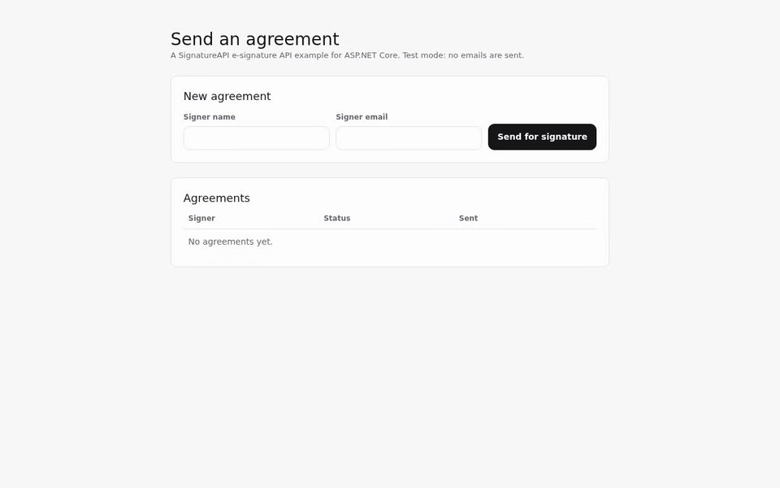
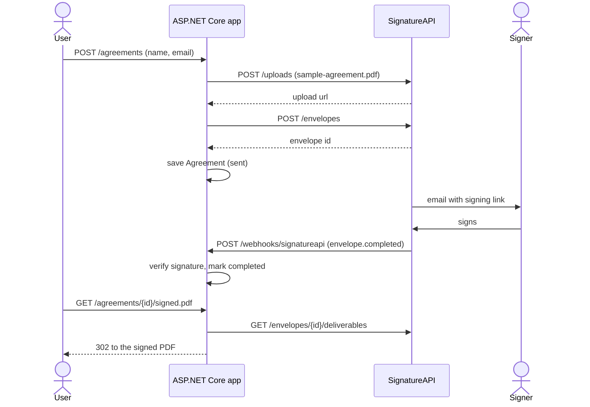

# SignatureAPI ASP.NET Core starter

A minimal ASP.NET Core template for sending documents for signature with the SignatureAPI e-signature API.

[](docs/media/demo.mp4)

## What it does

One page, no login:

1. **Send.** Enter a signer's name and email. The app uploads the bundled `sample-agreement.pdf`, creates an envelope, and saves an `Agreement` with status `sent`.
2. **Sign.** SignatureAPI emails the signer a signing link. The app never handles the link.
3. **Track.** A webhook verifies each event and updates the status: `completed`, `rejected`, `failed` or `canceled`.
4. **Download.** A completed agreement links to its signed PDF. The app asks SignatureAPI for a fresh download URL each time.

Stack: ASP.NET Core 8 Razor Pages, EF Core with SQLite, xUnit.

## Use this template

Select **Use this template** on GitHub to create your own repository, then follow the quickstart.

## Quickstart

Prerequisites: [.NET 8 SDK](https://dotnet.microsoft.com/download) and Node.js (for the SignatureAPI CLI).

```bash
# 1. Write a test API key to .env
npx --yes signatureapi init

# 2. Run the app on http://localhost:3000
dotnet run --project src/SignatureApiStarter

# 3. In another terminal, forward test webhooks to the app (writes the webhook secret to .env)
npx --yes signatureapi listen --forward-to http://127.0.0.1:3000/webhooks/signatureapi
```

Open http://localhost:3000 and send an agreement. Restart the app after the first `listen` so it reads the new webhook secret.

The app reads `SIGNATUREAPI_KEY` and `SIGNATUREAPI_WEBHOOK_SECRET` from `.env` or the environment (see `.env.example`). It stops at startup if the key is missing. The SQLite database is created at `src/SignatureApiStarter/app.db` on first run.

## How it works



Two files hold the integration:

- [`src/SignatureApiStarter/SignatureApi/SignatureApiClient.cs`](src/SignatureApiStarter/SignatureApi/SignatureApiClient.cs): every SignatureAPI call (upload, create envelope, list deliverables).
- [`src/SignatureApiStarter/SignatureApi/WebhookEndpoint.cs`](src/SignatureApiStarter/SignatureApi/WebhookEndpoint.cs): verifies webhook events with the [Standard Webhooks](https://github.com/standard-webhooks/standard-webhooks) library and updates the agreement.

The form lives in [`Pages/Index.cshtml`](src/SignatureApiStarter/Pages/Index.cshtml), the model in [`Data/Agreement.cs`](src/SignatureApiStarter/Data/Agreement.cs), and the routes in [`Program.cs`](src/SignatureApiStarter/Program.cs).

## AI agents

The repo comes set up for coding agents that work with SignatureAPI:

- `.claude/settings.json` installs the SignatureAPI Claude Code plugin (skills and MCP server), pinned to a commit of [signatureapi/skills](https://github.com/signatureapi/skills).
- `.agents/skills/` holds the same skills for Codex, Cursor, Copilot and other agents.
- `.cursor/mcp.json` and `.codex/config.toml` connect the SignatureAPI MCP server.
- `scripts/update-agent-skills.sh <commit-sha>` moves the pin.

See [`AGENTS.md`](AGENTS.md) for the rules agents follow in this repo.

## Tests

```bash
dotnet test
```

The unit tests replace SignatureAPI with a fake HTTP handler, so they need no key or network.

`e2e/` holds an end-to-end test that runs the real flow in test mode. It needs a test key and `signatureapi listen`, so it is not part of CI. See [`e2e/README.md`](e2e/README.md).

## Going to production

- Use a live API key (`key_live_...`) in your production environment.
- Register a webhook endpoint for your public URL in the [dashboard](https://dashboard.signatureapi.com/settings/webhooks) and set its secret as `SIGNATUREAPI_WEBHOOK_SECRET`.
- Add authentication for your users. This template has none.
- Deliverable URLs expire after an hour. If you need to keep the signed PDF, download it on `deliverable.generated` and store it.

## License

[MIT](LICENSE)
